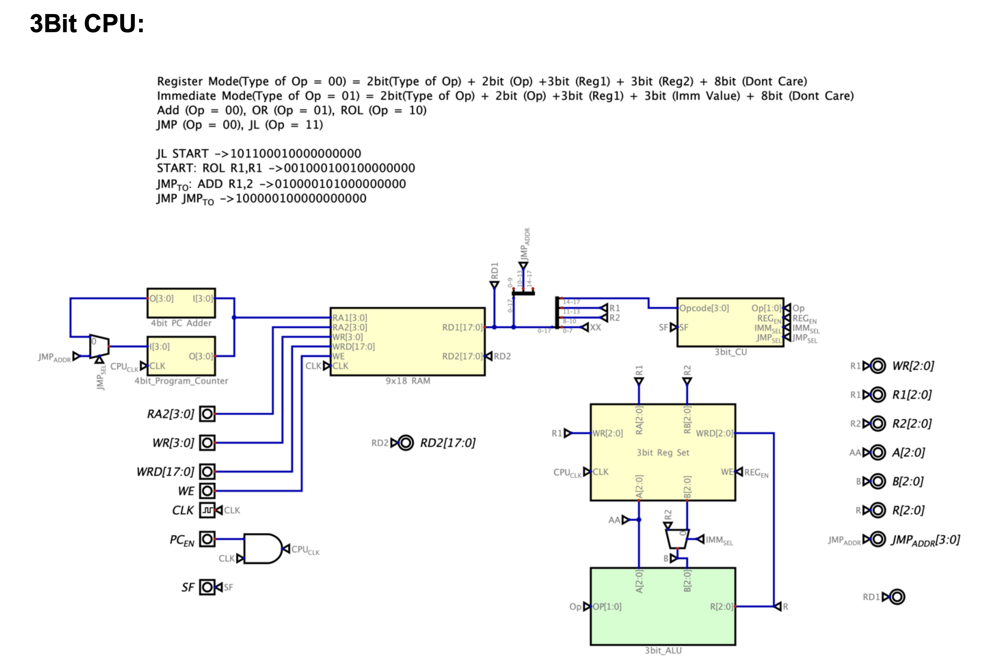
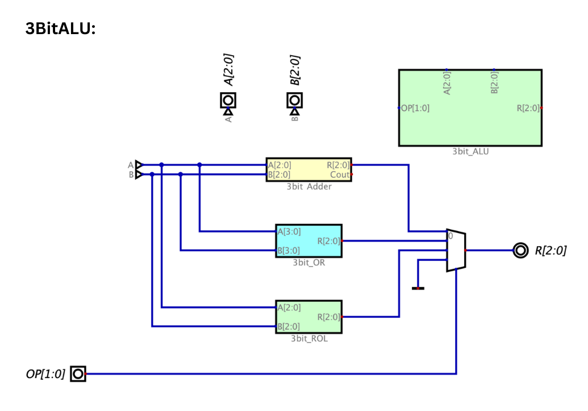
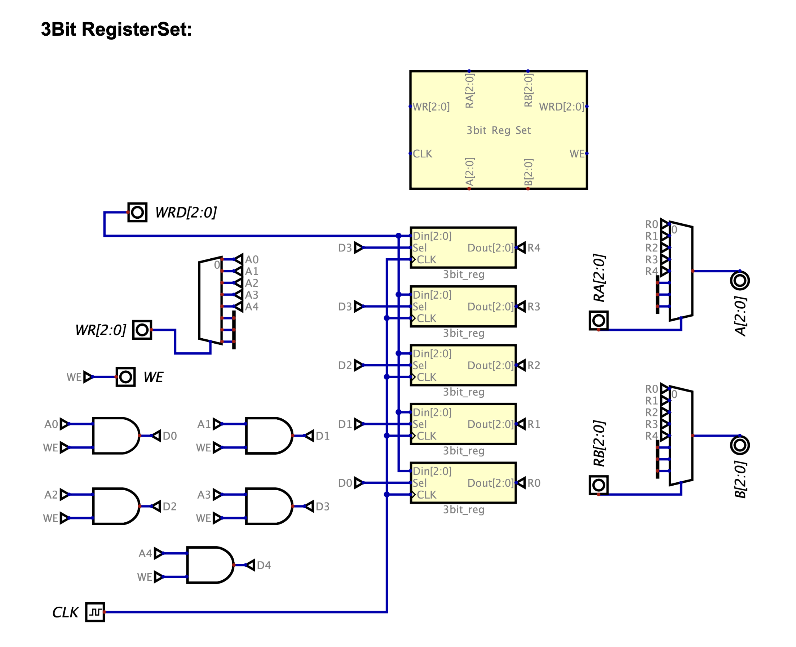

# 3-Bit Custom Microarchitecture CPU Simulation

A modular 3-bit microprocessor designed and simulated from gate-level logic up to a complete microarchitecture using the **Digital** logic simulator. The processor features an 18-bit Instruction Set Architecture (ISA), a 5-register register file, dual-port RAM, and support for arithmetic, logical, and control-flow (branching) instructions.

[](https://www.youtube.com/watch?v=Z4pHt0uK5ME)

---
### 🖥️ Complete Datapath & Top-Level Circuit


## 📌 Architectural Specifications

| Parameter | Specification | Details |
| :--- | :--- | :--- |
| **Data Word Size** | 3-bit | ALU and internal registers operate on 3-bit words |
| **Instruction / RAM Word Size** | 18-bit | Fixed-width instructions stored in memory |
| **Register File** | 5 General-Purpose Registers | `R0` through `R4` (3-bit width each) with dual-read ports |
| **Memory (RAM)** | 9 × 18-bit | Modular RAM with dual read ports (`RD1`, `RD2`) and single write port |
| **Program Counter (PC)** | 4-bit | Supports sequential incrementing and branch targets |
| **Supported Operations** | Arithmetic, Logical, Shift, Branch | `ADD`, `OR`, `ROL`, `JMP`, `JL` |

---

## ⚙️ Modular Circuit Hierarchy

The CPU is constructed hierarchically from primitive logic gates into functional sub-units:

1. **Arithmetic Logic Unit (ALU):**
   * **Full Adder & 3-Bit Ripple Adder:** Handles basic binary addition.
   * **3-Bit Bitwise OR:** Parallel gate-level bitwise operations.
   * **3-Bit Rotate Left (ROL):** Multiplexer-based circular barrel-shifter.
   * **Top-Level ALU:** Selects between `ADD (00)`, `OR (01)`, and `ROL (10)` based on control signals.
     
   

2. **Register File:**
   * Built from single-bit D-Flip-Flop storage cells with load-enable multiplexing.
   * Scaled into 3-bit registers and organized into a 5-register file (`R0`–`R4`) supporting independent two-channel reads (`RA`, `RB`) and synchronous write-back.
  
     

3. **Memory Subsystem (9×18 RAM):**
   * Constructed bottom-up: `1x1 RAM cell` $\rightarrow$ `1x18 RAM row` $\rightarrow$ `9x18 Dual-Port RAM`.
   * Enables simultaneous dual instruction/data reading alongside synchronized writes.

4. **Program Sequencing & Control Unit:**
   * **4-bit PC & Incrementor:** Dedicated 4-bit adder advances the PC sequentially (`PC + 1`) or loads direct jump targets.
   * **Control Unit:** Decodes opcode segments, generates register write-enables, selects ALU modes, and drives multiplexers for branching.

---

## 📑 Instruction Set Architecture (ISA)

The processor utilizes an 18-bit fixed-length encoding split across three primary operational modes:

| Mode | `[17:16]` (2b) | `[15:14]` (2b) | `[13:11]` (3b) | `[10:8]` (3b) | `[7:0]` (8b) |
| :--- | :---: | :---: | :---: | :---: | :---: |
| **Register** | `00` | ALU Op (`00`–`10`) | Reg A (`Ra`) | Reg B (`Rb`) | *Unused* |
| **Immediate**| `01` | ALU Op (`00`–`10`) | Reg A (`Ra`) | Constant / Imm | *Unused* |
| **Branch**   | `10` | Branch Op (`JMP`/`JL`)| Target Addr `[13:10]` (4b) | *Unused `[9:0]` (10b)* |
---

## 🧪 Verification & Sample Program

The CPU functionality was verified by assembling and stepping through a test program that exercises arithmetic, shifting, and conditional branching:

```assembly
Sample validation routine:
        JL START        ; 10 11 0001 0000000000 -> Branch if less condition
START:  ROL R1, R1      ; 00 10 001 001 00000000 -> Rotate register R1 left
JMP_TO: ADD R1, 2       ; 01 00 001 010 00000000 -> Immediate addition: R1 = R1 + 2
        JMP JMP_TO      ; 10 00 0010 0000000000 -> Unconditional loop
```
## 🛠️ Tools Used
* **Simulator:** [Digital Logic Simulator](https://github.com/hneemann/Digital)
